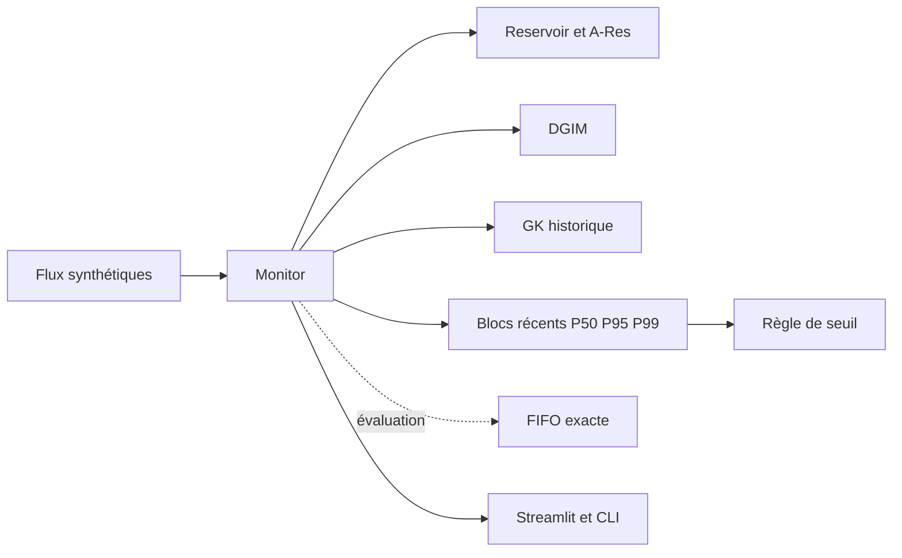
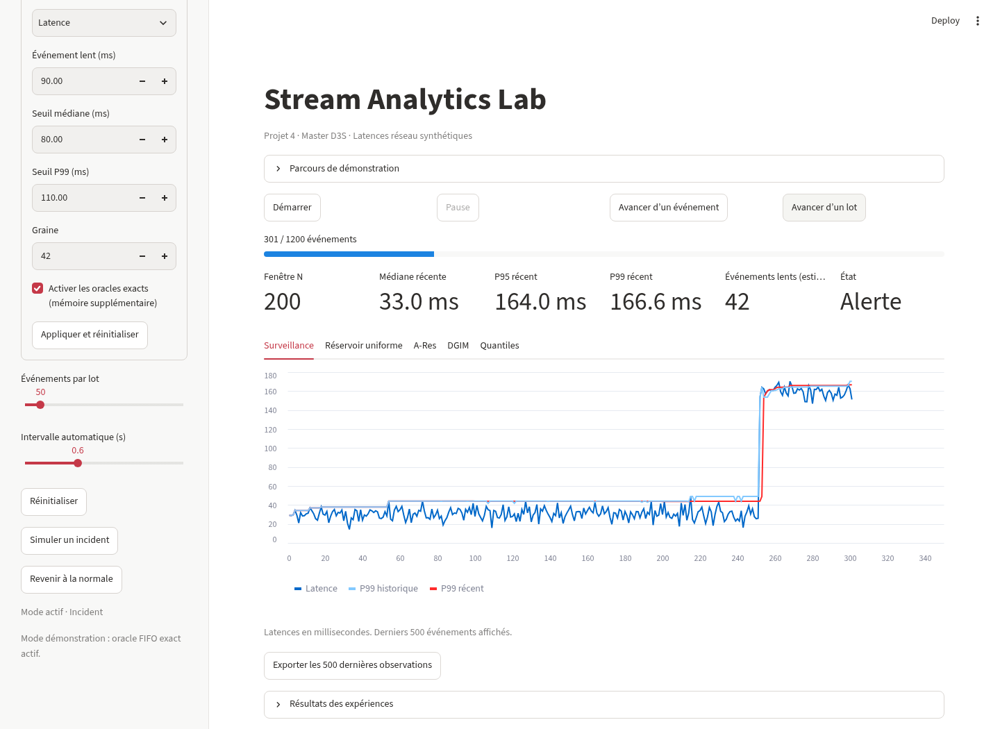

# Projet 4 · Échantillonnage et fenêtres glissantes

ISTIC, Master D3S · Nasr elhak Khemiri, Wajdi Zayoud, Youssif Cherni.

Le projet maintient des échantillons d’un flux de taille inconnue et estime le nombre d’événements lents ainsi que les quantiles de latence. Les quatre algorithmes sont écrits en Python. Les exemples utilisent des données synthétiques reproductibles.

Python 3.11 à 3.13 est la cible. La validation locale V4 a utilisé Python 3.13. Le workflow CI vérifie 3.11 et 3.13 lorsqu’il s’exécute sur GitHub.

```bash
python3 -m venv .venv
source .venv/bin/activate
python -m pip install -r requirements-dev.txt
python -m pytest -v
python demo.py --seed 42 --events 1200
python -m evaluation.benchmark --profile quick --output results/quick
python -m evaluation.benchmark --profile full
python -m streamlit run dashboard/app.py --server.address 127.0.0.1
```

Pour une exécution sans les tests, installer uniquement `requirements.txt`. Le navigateur de validation nécessite Playwright et Chrome. Le rapport et la soutenance utilisent `requirements-academic.txt`, Tectonic, Poppler, LibreOffice, DejaVu Sans et Liberation Serif. La [génération PowerPoint](presentation/README.md) réutilise le runtime Codex pour la mise en page. Le PPTX et le PDF déjà produits peuvent être ouverts sans ce runtime.

Avec Streamlit lancé par la commande ci-dessus, exécuter dans un second terminal `python -m evaluation.browser --url http://127.0.0.1:8501 --chrome /usr/bin/google-chrome`.

### Architecture





- `algorithms/` contient Algorithm R, A-Res, DGIM, GK historique et les quantiles récents par blocs.
- `streaming/` gère les distributions synthétiques, les mises à jour et les alertes.
- `evaluation/`, `tests/` et `results/` contiennent le protocole, les tests et les preuves exportées.
- `dashboard/` fournit une vue locale interactive. `demo.py` exécute le même moteur en ligne de commande.
- `docs/` contient l’audit, les exercices, le rapport et la préparation de la soutenance.

La démo de référence signale l’incident à l’événement 403 et montre le rétablissement à 998. Le P99 historique reste élevé après l’incident, tandis que le P99 récent diminue. Le profil complet produit 14 figures et 6 758 lignes de mesures. Le test T1 donne p = 0,6422.

Voir [garanties](docs/MATHEMATICAL_GUARANTEES.md), [protocole](docs/EXPERIMENTAL_PROTOCOL.md), [résultats](docs/SCIENTIFIC_RESULTS.md), [revue scientifique](docs/STATE_OF_THE_ART_FINAL.md), [validation V4](docs/FINAL_VALIDATION_V4.md) et [guide de démonstration](docs/DEMONSTRATION_GUIDE.md).

Les études complémentaires et la comparaison des alertes portent la collection à 22 figures. La persistance fait passer le F1 moyen de 0,345 à 0,791 sur les incidents répétés et rate les incidents isolés. Le [rapport final](docs/report/rapport-projet4-final.pdf) se reproduit avec `python -m evaluation.article` ([prérequis LaTeX](docs/report/README.md)). Les scripts et exercices PDF sont produits par `python -m evaluation.academic_pdfs` avec ReportLab.

Les expériences V4 comparent les requêtes groupées à l’ancienne méthode avec `python -m evaluation.query_benchmark`, et une règle facultative à la règle de seuil avec `python -m evaluation.alert_comparison`. L’accord avec la règle exacte et le F1 face aux incidents sont deux mesures distinctes. Les mesures et limites figurent dans [la validation V4](docs/FINAL_VALIDATION_V4.md).

- [Article scientifique](docs/report/rapport-projet4-final.pdf)
- [PowerPoint animé](presentation/Data_Stream_Mining_Final_Anime.pptx) et [version statique](presentation/Data_Stream_Mining_Final_Statique.pdf)
- [Script oral](presentation/Script_Oral_Complet_FR.pdf) et [questions de soutenance](presentation/Questions_Reponses_Soutenance.pdf)

Voir les [supports de soutenance](presentation/README.md), le [journal de navigateur](results/browser_validation/report.json) et la [grille de conformité](docs/REQUIREMENTS_TRACEABILITY.md).
